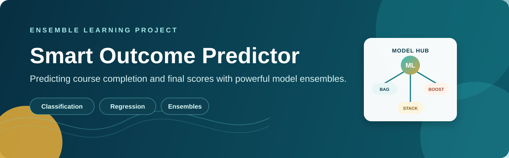
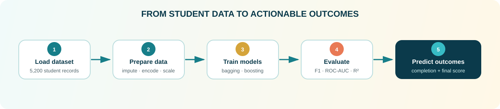
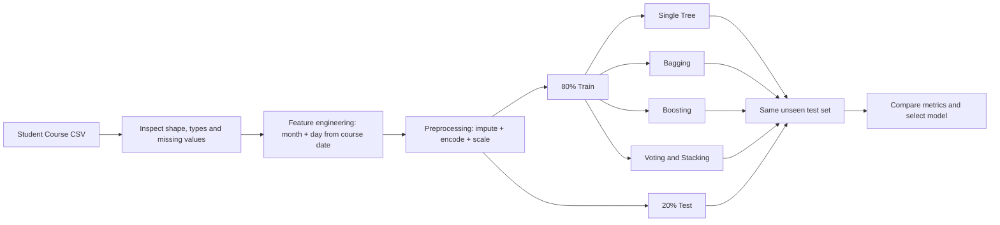
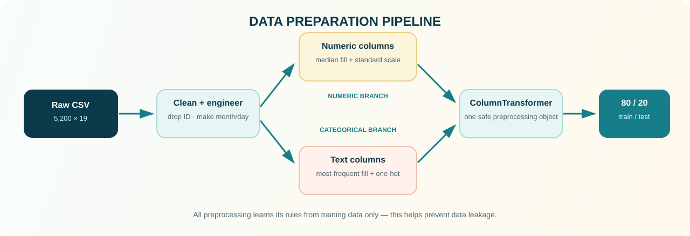
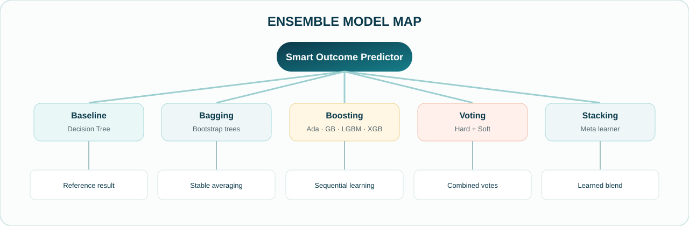
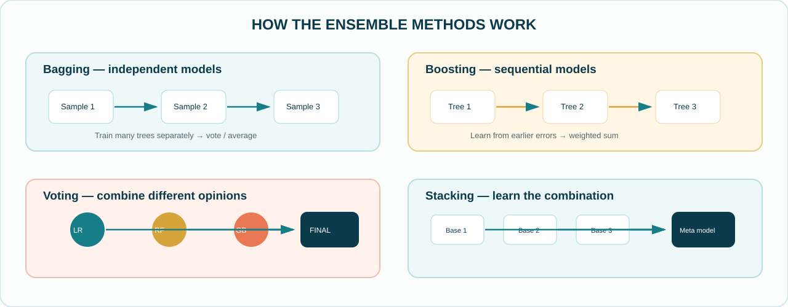
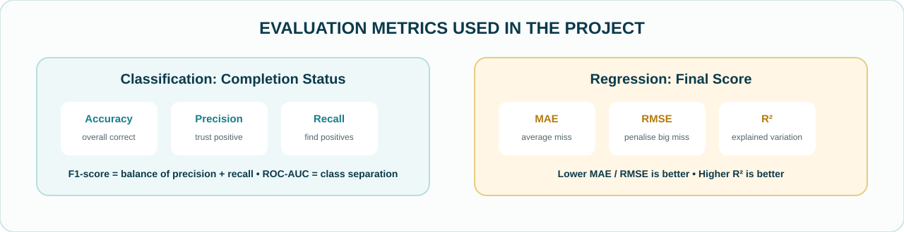
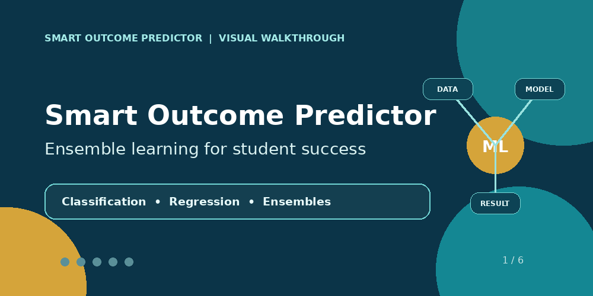

<div align="center">
  

  <br />

  <a href="Smart_Outcome_Predictor.ipynb"></a>
  <a href="Smart_Outcome_Predictor_Dataset.csv"></a>
  <a href="docs/Project_Question.pdf"></a>
  <a href="Smart_output_predictor_Theory.pdf"></a>
  <a href="assets/project_walkthrough.gif"></a>

  <br />
  <br />

  <a href="#project-overview">Overview</a> ·
  <a href="#project-workflow">Workflow</a> ·
  <a href="#results-at-a-glance">Results</a> ·
  <a href="#run-the-project">Run it</a> ·
  <a href="#project-resources">Resources</a>

  <br />
  <br />

  
  
  
  
  
</div>

---

## Project Overview

**Smart Outcome Predictor** is an ensemble-based machine learning project for online learning analytics. It uses student profile, course details, learning activity, and assessment behaviour to predict two useful outcomes:

| Prediction task | Target column | Output | ML problem |
|---|---|---:|---|
| **Course completion** | `completion_status` | `0` = not completed, `1` = completed | Binary classification |
| **Final performance** | `final_score` | Score from `0` to `100` | Regression |

The main purpose is to compare a single decision tree with several ensemble methods. The notebook then checks which approach performs best for each task.

> **Core idea:** one model can make mistakes. Ensemble learning combines several models so the final prediction can be more stable and accurate.

---

## Project Workflow

<div align="center">
  
</div>

1. **Load** the student course dataset.
2. **Clean and prepare** numeric, text, and date columns.
3. **Train** baseline and ensemble models for classification and regression.
4. **Evaluate** every model on the same unseen test split.
5. **Select** models using useful performance metrics and practical considerations.

### Detailed experiment flow



---

## Preprocessing Architecture

<div align="center">
  
</div>

The pipeline learns filling, encoding, and scaling rules from the training data only. This prevents test-set information from leaking into training.

```python
X_train, X_test, y_class_train, y_class_test, y_reg_train, y_reg_test = train_test_split(
    X, y_class, y_reg,
    test_size=0.20,
    random_state=42,
    stratify=y_class
)
```

---

## Dataset at a Glance

The project dataset contains **5,200 student records** and **19 columns**.

| Data group | Example columns | Why it matters |
|---|---|---|
| Student profile | `age`, `country_region`, `education_background` | Adds learning background context. |
| Course context | `device_type`, `course_level`, `course_category`, `course_start_date` | Describes where and how the learning happens. |
| Engagement | `sessions`, `time_spent_hours`, `videos_watched`, `forum_posts` | Shows student activity in the platform. |
| Assessment activity | `quiz_attempts`, `assignments_submitted`, `avg_quiz_score`, `attendance_rate` | Gives signals about progress and effort. |
| Target values | `completion_status`, `final_score` | The values predicted by the models. |

### Feature preparation used in the notebook

- `student_id` is removed because it is only an identifier.
- `course_start_date` is changed into `start_month` and `start_day`.
- Both target columns are removed from input features to prevent **data leakage**.
- Numeric missing values are filled with the **median**.
- Text categories are filled with the most common value and converted using **one-hot encoding**.
- Numeric features are standardised using `StandardScaler`.
- The data is split into **80% training** and **20% testing** data with `random_state = 42`.
- The classification split is **stratified**, so the class proportion stays similar in training and test data.

> A `ColumnTransformer` and `Pipeline` are used so the same preprocessing rules are applied safely to every model.

---

## What the Notebook Covers

The notebook is organised step by step to match the project questions.

<details open>
<summary><b>Part A — Ensemble Learning Theory</b></summary>

- What ensemble learning is and why it can improve prediction quality.
- Difference between **Bagging**, **Boosting**, and **Voting**.
- The **bias–variance trade-off**.
- Voting classifiers and stacking with a meta-learner.
- Basic idea of **AdaBoost**, **Gradient Boosting**, **LightGBM**, and **XGBoost**.
</details>

<details>
<summary><b>Part B — Dataset Understanding & Preparation</b></summary>

- Identify features and the two target columns.
- Inspect data types, shape, class balance, and missing values.
- Convert dates into simple month/day features.
- Build a clean train-test split.
- Impute, encode, and scale data through one reusable preprocessing pipeline.
</details>

<details>
<summary><b>Part C & D — Bagging and Boosting</b></summary>

- Compare a **single Decision Tree** with **Bagging Classifier** and **Bagging Regressor**.
- Build **AdaBoost** for completion prediction and final-score prediction.
- Build **Gradient Boosting** models and test different learning-rate / estimator settings.
- Train **LightGBM** models and inspect a simple speed comparison.
- Train **XGBoost** models with sampling and depth controls.
</details>

<details>
<summary><b>Part E & F — Voting, Stacking & Evaluation</b></summary>

- Create a **Hard Voting Classifier** and **Soft Voting Classifier**.
- Build a **Stacking Classifier** with Logistic Regression as the meta-model.
- Build a **Stacking Regressor** with Ridge as the meta-model.
- Create result tables, a confusion matrix, a classification report, and model-comparison charts.
</details>

<details>
<summary><b>Part G — Final Analysis</b></summary>

- Compare all models fairly on the same test set.
- Identify the strongest model for classification and regression.
- Discuss bagging vs boosting, deployment, responsible use, and future checks.
</details>

---

## Ensemble Model Map

<div align="center">
  
</div>

| Model family | Models implemented | Simple explanation |
|---|---|---|
| **Baseline** | Decision Tree Classifier / Regressor | A single tree gives the starting point for comparison. |
| **Bagging** | Bagging Classifier / Regressor | Trains many trees on bootstrap samples, then votes or averages. |
| **Boosting** | AdaBoost, Gradient Boosting, LightGBM, XGBoost | Builds trees one after another to reduce earlier errors. |
| **Voting** | Hard Voting, Soft Voting | Combines predictions from different ready-made classifiers. |
| **Stacking** | Stacking Classifier / Regressor | Uses a meta-model to learn how to combine base-model outputs. |

### Short model notes

- **Bagging** reduces variance by averaging many trees.
- **AdaBoost** gives more focus to previously misclassified rows.
- **Gradient Boosting** fits new trees to the remaining error (residual).
- **LightGBM** is designed for efficient gradient boosting and uses leaf-wise growth.
- **XGBoost** adds regularisation and sampling controls to limit overfitting.
- **Hard voting** chooses the class with the highest number of votes.
- **Soft voting** averages class probabilities.
- **Stacking** learns a better combination by using another model on top of base-model predictions.

### Bagging, Boosting, Voting and Stacking — visual comparison

<div align="center">
  
</div>

---

## Core Implementation — Main Notebook Code

The [Jupyter Notebook](Smart_Outcome_Predictor.ipynb) contains the complete runnable implementation and outputs. These main code blocks show exactly how the project is built.

<details open>
<summary><b>1. Imports and reproducible setup</b></summary>

```python
import pandas as pd
import numpy as np
import matplotlib.pyplot as plt
import seaborn as sns
import time
import warnings
warnings.filterwarnings("ignore")

from sklearn.model_selection import train_test_split
from sklearn.compose import ColumnTransformer
from sklearn.pipeline import Pipeline
from sklearn.impute import SimpleImputer
from sklearn.preprocessing import OneHotEncoder, StandardScaler
from sklearn.tree import DecisionTreeClassifier, DecisionTreeRegressor
from sklearn.ensemble import (
    BaggingClassifier, BaggingRegressor,
    AdaBoostClassifier, AdaBoostRegressor,
    GradientBoostingClassifier, GradientBoostingRegressor,
    RandomForestClassifier, RandomForestRegressor,
    VotingClassifier, StackingClassifier, StackingRegressor
)
from sklearn.linear_model import LogisticRegression, Ridge
from sklearn.metrics import (
    accuracy_score, precision_score, recall_score, f1_score, roc_auc_score,
    mean_absolute_error, mean_squared_error, r2_score
)
from lightgbm import LGBMClassifier, LGBMRegressor
from xgboost import XGBClassifier, XGBRegressor

RANDOM_STATE = 42
```
</details>

<details>
<summary><b>2. Load the CSV and make simple date features</b></summary>

```python
data = pd.read_csv("Smart_Outcome_Predictor_Dataset.csv")

print("Data shape:", data.shape)
print(data.isnull().sum())

# Convert a raw date into easy numeric date features
data["course_start_date"] = pd.to_datetime(
    data["course_start_date"], errors="coerce"
)
data["start_month"] = data["course_start_date"].dt.month
data["start_day"] = data["course_start_date"].dt.day
```
</details>

<details>
<summary><b>3. Targets, no-leakage feature set, and split</b></summary>

```python
# Classification target and regression target
y_class = data["completion_status"]
y_reg = data["final_score"]

# Remove ID, old date, and both targets from input features
X = data.drop(columns=[
    "student_id", "course_start_date",
    "completion_status", "final_score"
])

# One fair split is reused for every model
X_train, X_test, y_class_train, y_class_test, y_reg_train, y_reg_test = train_test_split(
    X, y_class, y_reg,
    test_size=0.20,
    random_state=RANDOM_STATE,
    stratify=y_class
)
```
</details>

<details>
<summary><b>4. Numeric and categorical preprocessing pipeline</b></summary>

```python
num_cols = X.select_dtypes(include=["int64", "float64"]).columns.tolist()
cat_cols = X.select_dtypes(include=["object", "category"]).columns.tolist()

num_pipe = Pipeline([
    ("fill_missing", SimpleImputer(strategy="median")),
    ("scale", StandardScaler())
])

cat_pipe = Pipeline([
    ("fill_missing", SimpleImputer(strategy="most_frequent")),
    ("one_hot", OneHotEncoder(handle_unknown="ignore", sparse_output=False))
])

preprocessor = ColumnTransformer([
    ("number", num_pipe, num_cols),
    ("text", cat_pipe, cat_cols)
])
```
</details>

<details>
<summary><b>5. Reusable metric functions</b></summary>

```python
class_results = []
reg_results = []

def save_class_result(name, y_true, y_pred, y_prob=None):
    class_results.append({
        "Model": name,
        "Accuracy": accuracy_score(y_true, y_pred),
        "Precision": precision_score(y_true, y_pred, zero_division=0),
        "Recall": recall_score(y_true, y_pred, zero_division=0),
        "F1-score": f1_score(y_true, y_pred, zero_division=0),
        "ROC-AUC": roc_auc_score(y_true, y_prob) if y_prob is not None else np.nan
    })

def save_reg_result(name, y_true, y_pred):
    reg_results.append({
        "Model": name,
        "MAE": mean_absolute_error(y_true, y_pred),
        "RMSE": np.sqrt(mean_squared_error(y_true, y_pred)),
        "R-square": r2_score(y_true, y_pred)
    })
```
</details>

### Bagging — bootstrap aggregation

```python
bag_clf = Pipeline([
    ("prep", preprocessor),
    ("model", BaggingClassifier(
        estimator=DecisionTreeClassifier(random_state=RANDOM_STATE),
        n_estimators=80,
        random_state=RANDOM_STATE,
        n_jobs=-1
    ))
])

bag_clf.fit(X_train, y_class_train)
bag_pred = bag_clf.predict(X_test)
bag_prob = bag_clf.predict_proba(X_test)[:, 1]
save_class_result("Bagging Classifier", y_class_test, bag_pred, bag_prob)

bag_reg = Pipeline([
    ("prep", preprocessor),
    ("model", BaggingRegressor(
        estimator=DecisionTreeRegressor(random_state=RANDOM_STATE),
        n_estimators=80,
        random_state=RANDOM_STATE,
        n_jobs=-1
    ))
])
bag_reg.fit(X_train, y_reg_train)
save_reg_result("Bagging Regressor", y_reg_test, bag_reg.predict(X_test))
```

### AdaBoost and Gradient Boosting

```python
# AdaBoost: later weak learners give more focus to earlier mistakes
ada_clf = Pipeline([
    ("prep", preprocessor),
    ("model", AdaBoostClassifier(
        estimator=DecisionTreeClassifier(max_depth=1, random_state=RANDOM_STATE),
        n_estimators=100,
        learning_rate=0.8,
        random_state=RANDOM_STATE
    ))
])

# Gradient Boosting: each new tree learns from the remaining error
gb_reg = Pipeline([
    ("prep", preprocessor),
    ("model", GradientBoostingRegressor(
        n_estimators=100,
        learning_rate=0.1,
        max_depth=3,
        random_state=RANDOM_STATE
    ))
])
```

### LightGBM and XGBoost

```python
lgb_clf = Pipeline([
    ("prep", preprocessor),
    ("model", LGBMClassifier(
        n_estimators=120,
        learning_rate=0.05,
        num_leaves=25,
        random_state=RANDOM_STATE,
        verbosity=-1
    ))
])

xgb_reg = Pipeline([
    ("prep", preprocessor),
    ("model", XGBRegressor(
        n_estimators=120,
        learning_rate=0.05,
        max_depth=4,
        subsample=0.8,
        colsample_bytree=0.8,
        random_state=RANDOM_STATE,
        n_jobs=-1
    ))
])
```

### Hard / Soft Voting

```python
log_clf = Pipeline([
    ("prep", preprocessor),
    ("model", LogisticRegression(max_iter=1000, random_state=RANDOM_STATE))
])
rf_clf = Pipeline([
    ("prep", preprocessor),
    ("model", RandomForestClassifier(
        n_estimators=100, random_state=RANDOM_STATE, n_jobs=-1
    ))
])
gb_vote_clf = Pipeline([
    ("prep", preprocessor),
    ("model", GradientBoostingClassifier(n_estimators=80, random_state=RANDOM_STATE))
])

hard_vote = VotingClassifier(
    estimators=[("log", log_clf), ("rf", rf_clf), ("gb", gb_vote_clf)],
    voting="hard"
)
soft_vote = VotingClassifier(
    estimators=[("log", log_clf), ("rf", rf_clf), ("gb", gb_vote_clf)],
    voting="soft"
)
```

### Stacking with a meta-model

```python
# cv=5 gives out-of-fold predictions to the final model
stack_clf = StackingClassifier(
    estimators=[("log", log_clf), ("rf", rf_clf), ("gb", gb_vote_clf)],
    final_estimator=LogisticRegression(max_iter=1000, random_state=RANDOM_STATE),
    cv=5,
    n_jobs=-1
)

stack_reg = StackingRegressor(
    estimators=[("rf", rf_reg), ("gb", gb_stack_reg), ("tree", tree_reg)],
    final_estimator=Ridge(),
    cv=5,
    n_jobs=-1
)
```

### Sort the result tables and create a comparison chart

```python
class_table = pd.DataFrame(class_results).sort_values(
    "F1-score", ascending=False
).reset_index(drop=True)

reg_table = pd.DataFrame(reg_results).sort_values(
    "R-square", ascending=False
).reset_index(drop=True)

plt.figure(figsize=(9, 5))
show_class = class_table.sort_values("F1-score")
plt.barh(show_class["Model"], show_class["F1-score"], color="steelblue")
plt.xlabel("F1-score")
plt.title("Classification Model Comparison")
plt.tight_layout()
plt.show()
```

> The notebook also contains a single-tree baseline, AdaBoost / Gradient Boosting classifiers and regressors, learning-rate testing, LightGBM timing, confusion matrix, classification report, and final conclusion cells.

---

## Evaluation Visual Map

<div align="center">
  
</div>

---

## Results at a Glance

> Results below are from the executed notebook using the fixed 80/20 split. Small changes can happen with library versions or hardware.

### Classification — predicting course completion

| Rank by F1-score | Model | Accuracy | Precision | Recall | F1-score | ROC-AUC |
|---:|---|---:|---:|---:|---:|---:|
| 1 | **Hard Voting Classifier** | **0.7462** | **0.6933** | 0.5795 | **0.6313** | — |
| 2 | XGBoost Classifier | 0.7365 | 0.6676 | **0.5923** | 0.6277 | 0.7844 |
| 3 | Gradient Boosting Classifier | 0.7385 | 0.6756 | 0.5821 | 0.6253 | 0.7880 |
| 4 | Stacking Classifier | 0.7413 | 0.6873 | 0.5692 | 0.6227 | **0.7946** |
| 5 | Soft Voting Classifier | 0.7375 | 0.6778 | 0.5718 | 0.6203 | 0.7931 |
| 6 | LightGBM Classifier | 0.7308 | 0.6647 | 0.5692 | 0.6133 | 0.7841 |
| 7 | AdaBoost Classifier | 0.7279 | 0.6656 | 0.5513 | 0.6031 | 0.7868 |
| 8 | Bagging Classifier | 0.7048 | 0.6277 | 0.5231 | 0.5706 | 0.7561 |
| 9 | Single Decision Tree | 0.6298 | 0.5062 | 0.5256 | 0.5157 | 0.6090 |

**Classification takeaway:** The **Hard Voting Classifier** gives the highest F1-score and accuracy in this run. It does not provide probabilities, so ROC-AUC is not available. For probability-based ranking, the **Stacking Classifier** gives the highest ROC-AUC.

### Regression — predicting final score

| Rank by R² | Model | MAE ↓ | RMSE ↓ | R² ↑ |
|---:|---|---:|---:|---:|
| 1 | **XGBoost Regressor** | **8.1316** | **10.0955** | **0.4401** |
| 2 | Stacking Regressor | 8.1909 | 10.1884 | 0.4298 |
| 3 | Gradient Boosting Regressor | 8.2072 | 10.1998 | 0.4285 |
| 4 | LightGBM Regressor | 8.2089 | 10.2646 | 0.4212 |
| 5 | Bagging Regressor | 8.2934 | 10.3295 | 0.4139 |
| 6 | AdaBoost Regressor | 8.7095 | 10.6691 | 0.3747 |
| 7 | Single Decision Tree | 11.0373 | 13.9998 | -0.0766 |

**Regression takeaway:** The **XGBoost Regressor** has the best R² and lowest MAE/RMSE in this experiment. On average, its score predictions are about **8.13 marks** away from the actual score.

---

## Metrics Used

### Classification metrics

| Metric | Meaning | Better value |
|---|---|---|
| **Accuracy** | Overall fraction of correct predictions. | Higher |
| **Precision** | When the model predicts completion, how often it is correct. | Higher |
| **Recall** | How many actual completions the model finds. | Higher |
| **F1-score** | Balance between precision and recall. | Higher |
| **ROC-AUC** | How well the model separates the two classes across thresholds. | Higher |

### Regression metrics

| Metric | Meaning | Better value |
|---|---|---|
| **MAE** | Average absolute prediction error in score points. | Lower |
| **RMSE** | Error measure that penalises large misses more strongly. | Lower |
| **R²** | How much variation in final score is explained by the model. | Higher |

---

## Visual Explanation Walkthrough

<div align="center">
  <a href="assets/project_walkthrough.gif">
    
  </a>
  <br />
  <sub>Click the animation to open the full visual walkthrough.</sub>
</div>

---

## Run the Project

### 1) Clone the repository

```bash
git clone https://github.com/DevanshiCodesAI/Smart_Outcome_Predictor.git
cd Smart_Outcome_Predictor
```

### 2) Create and activate a virtual environment *(recommended)*

```bash
python -m venv .venv

# Windows
.venv\Scripts\activate

# macOS / Linux
source .venv/bin/activate
```

### 3) Install packages

```bash
pip install -r requirements.txt
```

### 4) Launch Jupyter Notebook

```bash
jupyter notebook Smart_Outcome_Predictor.ipynb
```

> The notebook expects `Smart_Outcome_Predictor_Dataset.csv` to stay in the same folder as the notebook.

---

## Project Structure

```text
Smart_Outcome_Predictor/
│
├── Smart_Outcome_Predictor.ipynb          # Full ML implementation and outputs
├── Smart_Outcome_Predictor_Dataset.csv    # Student course dataset
├── Smart_output_predictor_Theory.pdf       # Theory guide with formulas and diagrams
├── README.md                               # Project documentation
├── requirements.txt                        # Python libraries
│
├── assets/
│   ├── banner.svg                          # README banner
│   ├── workflow.svg                        # End-to-end workflow visual
│   ├── model-map.svg                       # Ensemble model visual
│   ├── preprocessing-flow.svg               # Data preparation visual
│   ├── ensemble-workflow.svg                # Ensemble-method visual
│   ├── metrics-map.svg                      # Evaluation-metric visual
│   └── project_walkthrough.gif              # Animated visual explanation
│
└── docs/
    └── Project_Question.pdf                # Original project question
```

---

## Project Resources

| Resource | Description |
|---|---|
| [Open Jupyter Notebook](Smart_Outcome_Predictor.ipynb) | Complete code, preprocessing, model training, metrics, charts, and conclusions. |
| [Explore Dataset](Smart_Outcome_Predictor_Dataset.csv) | Original CSV file used for both ML tasks. |
| [Read Project Question](docs/Project_Question.pdf) | Original assignment brief and required tasks. |
| [Read Theory PDF](Smart_output_predictor_Theory.pdf) | Easy theory guide with formulas, diagrams, and model explanations. |
| [Watch Visual Explanation](assets/project_walkthrough.gif) | Short animated walkthrough of the project flow. |

---

## Responsible Use

This project is meant to support learning analytics. Predictions should be used to offer help, reminders, or extra resources — not to permanently label a student.

Before real deployment:

- Check data privacy and remove unnecessary personal information.
- Check whether model quality is similar across student groups.
- Keep a human in the decision process.
- Monitor for missing values, changed course behaviour, and model drift.
- Re-train and re-evaluate when new data patterns appear.

---

## Future Improvements

- Add cross-validation and hyperparameter optimisation.
- Test feature importance and SHAP explanations.
- Add a simple Streamlit or Flask dashboard.
- Save the selected pipeline with `joblib` for prediction on new records.
- Create a real-time support recommendation system for students at risk.
- Add a narrated explanation video linked from the project resources.

---

<div align="center">
  <b>Built for the Smart Outcome Predictor ensemble learning project.</b>
  <br />
  <sub>From student activity data to clearer learning-support insights.</sub>
</div>
